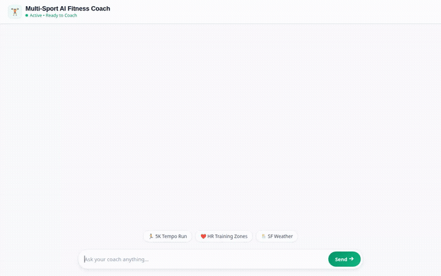

# Multi-Sport AI Fitness Coach



An intelligent, multi-sport fitness coaching assistant built with Google Agent Development Kit (ADK), Gemini 2.5 Flash, Vertex AI Memory Bank, and Google Cloud services. The coach provides personalized workout guidance, heart rate zone calculations, real-time outdoor weather checks, AI-generated achievement badges, and video demonstrations across running, cycling, swimming, weightlifting, and triathlon.

---

## Key Features & Supported Capabilities

### 🧠 Durable Memory & Personalization (Vertex AI Memory Bank)
- **Session Memory Persistence**: Powered by `VertexAiMemoryBankService` and `PreloadMemoryTool`.
- Automatically extracts and retains user fitness goals, medical/injury history, equipment preferences, and past performance across multi-turn sessions.

### 🏋️ Database-Driven Workout Management (Google Cloud Firestore)
- **Workout Routine Search (`search_workouts`)**: Queries the Firestore `workouts` collection filtered by sport (running, cycling, swimming, etc.), category, and difficulty.
- **Detailed Instructions (`get_workout_details`)**: Fetches step-by-step exercise structure, sets, reps, and pacing guidelines.
- **Workout Logging (`log_workout`)**: Persists completed workout sessions and athlete notes directly to user history in Firestore.

### 🎨 AI Graphic Badge Generation (Gemini Image Model & Cloud Storage)
- **Achievement Badge Tool (`generate_achievement_badge`)**: Uses `gemini-3.1-flash-lite-image` in the `global` region to generate custom vector-style reward badges.
- **Public Cloud Storage Hosting**: Streams generated PNG bytes directly to a public Google Cloud Storage bucket (`multi-sport-fitness-coach-assets-c53b8191d8d2`) and saves session artifacts for UI rendering.

### 🎬 AI Video Workout Demonstration (Google Omni Model)
- **Video Generation Tool (`generate_workout_video`)**: Uses Google's Omni model (`gemini-omni-flash-preview`) via Vertex AI Interactions API in the `global` region to produce short exercise video clips.
- Streams generated MP4 video bytes directly to public Cloud Storage and registers artifacts with the ADK session context.

### 📊 Heart Rate Zone Calculation & Weather API
- **Heart Rate Zone Tool (`calculate_training_zones`)**: Uses the Karvonen formula with maximum and resting heart rate metrics to compute target zones (Zone 1 Recovery through Zone 5 Anaerobic).
- **Outdoor Training Conditions (`get_outdoor_training_conditions`)**: Fetches real-time temperature, wind speed, weather code, and precipitation from the Open-Meteo REST API.

### 💻 Code Execution Sandbox
- **Vertex AI Agent Engine Sandbox (`AgentEngineSandboxCodeExecutor`)**: Executes Python code in a sandboxed environment for data analysis, pace conversions, and complex fitness calculations.

### 🖼️ Rich UI Surfaces (A2UI v0.8)
- **Structured Component Catalog**: Uses `A2uiSchemaManager` and custom callbacks (`a2ui_callback`) to render structured UI components (`Card`, `Column`, `Row`, `Text`, `Image`) in the web interface.

---

## System Architecture & GCP Services

| Component | Service / Technology | Purpose |
| :--- | :--- | :--- |
| **Agent Framework** | Google Agent Development Kit (ADK) | Multi-tool orchestration & callback lifecycle |
| **Primary Model** | `gemini-2.5-flash` | Reasoning, workout recommendations, and A2UI generation |
| **Image Generation** | `gemini-3.1-flash-lite-image` | Custom achievement badge graphics |
| **Video Generation** | `gemini-omni-flash-preview` | Short workout video demonstrations |
| **Memory Bank** | Vertex AI Memory Bank | Cross-session user state & preference recall |
| **Database** | Google Cloud Firestore | Workout routine library & workout logging |
| **Asset Storage** | Google Cloud Storage | Public hosting for generated PNG badges & MP4 videos |
| **Code Sandbox** | Vertex AI Agent Engine Sandbox | Isolated Python code execution |
| **Weather API** | Open-Meteo REST API | Real-time weather data for outdoor sports |
| **Frontend UI** | FastAPI / HTML / Vanilla CSS | Responsive chat interface with A2UI component rendering |

---

## Local Setup & Development Guide

### Prerequisites
- Python 3.11+
- `uv` package manager (`pip install uv`)
- Google Cloud SDK (`gcloud`) authenticated with a project containing Firestore, Vertex AI APIs, and Cloud Storage.

### Environment Configuration

Set the required Google Cloud environment variables in your terminal:

```bash
export GOOGLE_CLOUD_PROJECT="your-gcp-project-id"
export GOOGLE_CLOUD_REGION="us-east1"
```

If connecting to a deployed Agent Engine resource, set:

```bash
export AGENT_ENGINE_RESOURCE_NAME="projects/YOUR_PROJECT_NUMBER/locations/us-east1/reasoningEngines/YOUR_ENGINE_ID"
export AGENT_DIRECTORY="$(pwd)/app"
```

### Installation

1. Clone the repository and navigate to the project root:
   ```bash
   cd multi-sport-fitness-coach
   ```

2. Sync project dependencies:
   ```bash
   uv sync
   ```

### Running Locally

1. **Launch the FastAPI Web Frontend**:
   ```bash
   uv run python frontend/main.py
   ```
   The local server will start on port `8080`.

2. **Launch ADK Web Playground (Optional)**:
   ```bash
   acli playground launch
   ```

---

## Project Structure

```
multi-sport-fitness-coach/
├── app/
│   ├── __init__.py
│   ├── a2ui_utils.py       # A2UI response formatting & callback handlers
│   ├── agent.py            # ADK Agent definition, system instructions, and tool bindings
│   └── tools.py            # Firestore, Memory, Weather, Image, and Video tools
├── frontend/
│   ├── main.py             # FastAPI web server and A2A proxy endpoints
│   └── static/
│       └── index.html      # Rebranded frontend interface & A2UI renderer
├── agents-cli-manifest.yaml # Agent deployment manifest configuration
├── demo.gif                # Looping demonstration recording
└── pyproject.toml          # Python project dependencies
```
